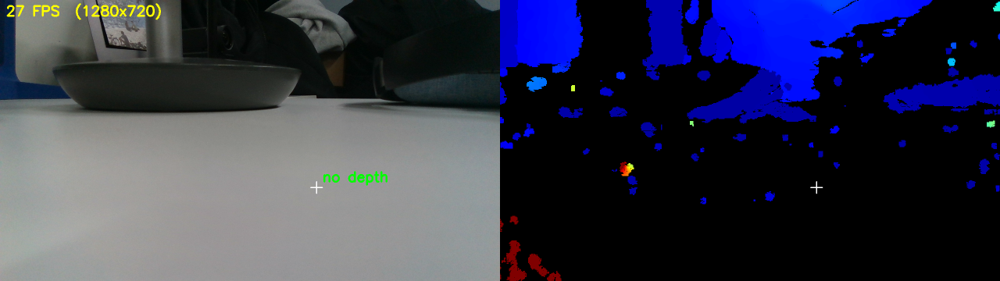

# realsense_opencv_viewer

Intel RealSense 카메라의 ROS 2 토픽을 **cv_bridge**로 받아 **OpenCV** 창에 띄우는 ROS 2 Python 패키지입니다.

- 컬러 이미지와, 컬러 화면에 맞춘 depth(aligned depth)를 나란히 보여 줍니다
- 마우스가 가리키는 점(기본: 화면 가운데)까지의 거리를 m 단위로 표시합니다
- depth는 0~5 m 범위를 컬러맵으로 칠합니다 (파랑 가까움 · 빨강 멂 · 검정 값 없음)



## 확인한 환경

| 항목 | 버전 |
|---|---|
| OS | Ubuntu 22.04 |
| ROS | ROS 2 Humble |
| 카메라 | Intel RealSense D435i |
| SDK / ROS 래퍼 | librealsense 2.54.1 / realsense-ros 4.54.1 |
| OpenCV / cv_bridge | 4.5.4 (Ubuntu apt) / ROS Humble 기본 |

realsense-ros 4.55 이상(최신)에서는 토픽 이름이 `/camera/camera/...` 형식입니다. 이때는 `camera_ns:=/camera/camera`로 실행하세요.

## 설치

RealSense SDK(librealsense)와 realsense-ros가 먼저 설치되어 있어야 합니다.

```bash
cd ~/realsense_ws/src          # realsense-ros 가 있는 워크스페이스
git clone https://github.com/ingyu0808/realsense_opencv_viewer.git

cd ~/realsense_ws
conda deactivate 2>/dev/null   # conda base 가 켜져 있으면 빌드가 실패한다
source /opt/ros/humble/setup.bash
colcon build --symlink-install --packages-select realsense_opencv_viewer
source install/setup.bash
```

필요한 파이썬 모듈(`cv2`, `numpy`, `cv_bridge`, `message_filters`)은 ROS 2 Humble desktop을 설치하면 함께 들어옵니다.

> `package.xml`에 `realsense2_camera`를 의존성으로 넣지 않았습니다. 넣으면 `rosdep`이 최신 `ros-humble-realsense2-camera`를 설치하려 해서, L515 때문에 버전을 고정한 환경(librealsense 2.54.1)과 충돌할 수 있기 때문입니다.

## 실행

### 카메라와 뷰어를 한 번에

```bash
ros2 launch realsense_opencv_viewer viewer.launch.py
```

`realsense2_camera`를 `align_depth.enable:=true`로 함께 띄웁니다. 뷰어 창에서 **q** 또는 **ESC**를 누르면 launch 전체가 종료됩니다.

### 카메라가 이미 실행 중일 때

```bash
# 터미널 1 — align_depth 를 꼭 켠다
ros2 launch realsense2_camera rs_launch.py align_depth.enable:=true

# 터미널 2
ros2 run realsense_opencv_viewer rs_opencv_viewer
# 또는
ros2 launch realsense_opencv_viewer viewer.launch.py launch_camera:=false
```

### 창 없이 한 장 저장

```bash
ros2 run realsense_opencv_viewer rs_opencv_viewer --ros-args -p save_path:=out.png
```

1.5초 동안 프레임을 받은 뒤 `out.png`로 저장하고 종료합니다.

## 파라미터

| 이름 | 기본값 | 설명 |
|---|---|---|
| `camera_ns` | `/camera` | 카메라 토픽 앞부분. 구독하는 토픽은 `<camera_ns>/color/image_raw`, `<camera_ns>/aligned_depth_to_color/image_raw` |
| `depth_scale` | `0.001` | depth 값 1이 몇 m인지 (D435i는 mm 단위라 0.001) |
| `display_scale` | `0.5` | 창 크기 배율 |
| `save_path` | `''` | 지정하면 창 없이 한 장 저장하고 종료 |

launch 파일은 `launch_camera`(기본 `true`), `camera_ns`, `display_scale`, `save_path`를 인자로 받습니다.

## 코드 핵심

```python
# reliable QoS(큐 10)로 구독
color = Subscriber(self, Image, f'{ns}/color/image_raw', qos_profile=10)
depth = Subscriber(self, Image, f'{ns}/aligned_depth_to_color/image_raw', qos_profile=10)
# 시각이 50 ms 안쪽인 컬러·depth를 짝지어 받기
sync = ApproximateTimeSynchronizer([color, depth], queue_size=10, slop=0.05)
sync.registerCallback(self.on_frames)

def on_frames(self, color_msg, depth_msg):
    self.color = self.bridge.imgmsg_to_cv2(color_msg, 'bgr8')         # uint8 (H, W, 3), BGR
    self.depth = self.bridge.imgmsg_to_cv2(depth_msg, 'passthrough')  # uint16 (H, W), mm

# 거리[m] = depth[y, x] * 0.001
```

| 토픽 | 인코딩 | 변환 | 결과 |
|---|---|---|---|
| `/camera/color/image_raw` | rgb8 | `'bgr8'` | `uint8 (720, 1280, 3)` (OpenCV는 BGR 순서) |
| `/camera/aligned_depth_to_color/image_raw` | 16UC1 | `'passthrough'` | `uint16 (720, 1280)`, mm |

## 주의: 큰 이미지는 reliable QoS로 받기

`qos_profile_sensor_data`(best effort)로 구독하면 1280x720 이미지가 전송 중 조각 하나만 잃어도 통째로 버려집니다. D435i + rmw_fastrtps_cpp에서 측정한 결과는 다음과 같습니다.

| 토픽 | best effort | reliable |
|---|---|---|
| `/camera/color/image_raw` | 11.0 Hz | 30.0 Hz |
| `/camera/aligned_depth_to_color/image_raw` | 10.8 Hz | 30.2 Hz |
| 이 뷰어 (`save_path` 모드) | 5 FPS | 31 FPS |

같은 이유로 `ros2 topic hz /camera/color/image_raw`도 실제보다 낮게 나옵니다. Humble의 `ros2 topic hz`는 항상 best effort로 구독하기 때문입니다. 주기는 `camera_info` 토픽으로 재세요.

## 문제 해결

| 증상 | 해결 |
|---|---|
| `... 를 기다리는 중입니다` 경고만 나옴 | 카메라 노드를 `align_depth.enable:=true`로 실행했는지, `camera_ns`가 맞는지 확인 (`ros2 topic list`) |
| 오른쪽 depth가 대부분 검정 | 물체가 너무 가까움. D435i는 약 0.2 m보다 가까우면 거리를 재지 못함 |
| 창이 뜨자마자 닫힘 (직접 수정한 경우) | Ubuntu apt의 OpenCV 4.5.4(GTK)는 `WND_PROP_VISIBLE`을 지원하지 않아 항상 -1을 돌려줌. 창 닫힘 검사는 `WND_PROP_AUTOSIZE < 0`으로 |
| `colcon build`에서 `No module named 'em'` | `conda deactivate` 후 `rm -rf build install log` 하고 다시 빌드 |

## 테스트

```bash
colcon test --packages-select realsense_opencv_viewer
colcon test-result --verbose
```

카메라 없이 합성 이미지로 화면 합성 함수(`make_view`)를 확인합니다.

## 라이선스

Apache-2.0
